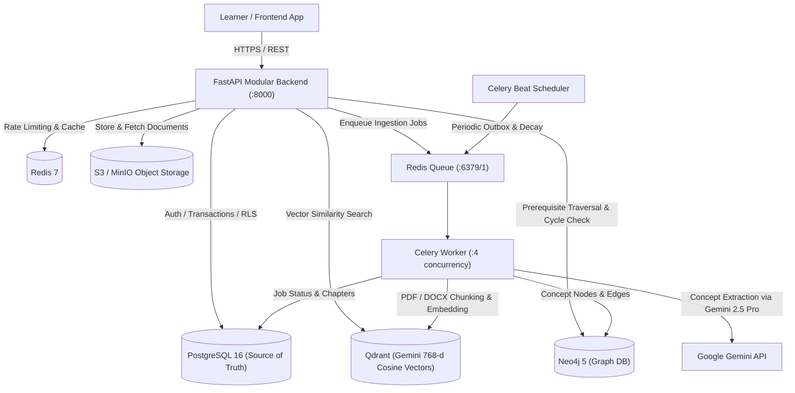

# MindGenome AI — Backend & Platform Architecture

> **Personal knowledge genome and adaptive learning platform.**  
> Continuous loop: **UPLOAD $\rightarrow$ NLP $\rightarrow$ CONCEPTS $\rightarrow$ GRAPH $\rightarrow$ LEARN $\rightarrow$ QUIZ $\rightarrow$ MASTERY $\rightarrow$ DEPENDENCIES $\rightarrow$ REMEDIAL / NEXT $\rightarrow$ UPDATED GENOME**

---

## 1. System Architecture

MindGenome AI is engineered as a **modular monolith** with three specialized datastores and an asynchronous Celery task pipeline:



### Core Components
| Datastore / Service | Role & Responsibility |
| :--- | :--- |
| **PostgreSQL 16** | **Source of Truth (SoT)**. All users, documents, chapters, chunks, concepts, questions, attempts, mastery history, and outbox records. Enforces Row-Level Security (`app.current_user_id`). |
| **Neo4j 5** | **Knowledge Graph**. Manages `Concept` nodes, `PREREQUISITE_OF` edges (enforcing cycle prevention via DAG algorithms), and `STRUGGLES_WITH` diagnostic edges. |
| **Qdrant** | **Vector Database**. Stores versioned, normalized 768-dimensional dense embeddings from Gemini `gemini-embedding-001` with cosine distance and hard `user_id` payload filters for tenant isolation. |
| **Redis 7** | Cache, sliding-window rate limiting (5 req/min on auth, 100 req/min on API), and Celery task broker. |
| **MinIO / S3** | Encrypted object storage for uploaded lecture notes, textbooks, and parsed chapter payloads. |
| **Celery Worker** | Asynchronous multi-stage document ingestion pipeline (`queued` $\rightarrow$ `parsing` $\rightarrow$ `chunking` $\rightarrow$ `embedding` $\rightarrow$ `extracting` $\rightarrow$ `graph_built` $\rightarrow$ `ready`). |
| **Celery Beat** | Periodic tasks: transactional outbox email delivery (every 30s), spaced repetition schedule recalculation (every 4h), and expired token pruning (daily). |

---

## 2. Directory Structure

```text
backend/
├── alembic/                      # Database migrations
│   ├── versions/
│   │   └── 001_initial.py       # Full baseline migration (22 tables, 15 enums, RLS)
│   └── env.py
├── app/
│   ├── adapters/                 # External service clients with memory fallbacks
│   │   ├── email.py              # SMTP client + Transactional Outbox
│   │   ├── gemini.py             # Gemini 2.5 Pro client + Structured outputs
│   │   ├── google_oauth.py       # Google OAuth PKCE exchange
│   │   ├── neo4j.py              # Neo4j Cypher queries + Cycle checks
│   │   ├── qdrant.py             # Qdrant vector collection manager
│   │   ├── redis.py              # Sliding-window rate limiter
│   │   └── storage.py            # S3 / MinIO adapter + local disk fallback
│   ├── api/
│   │   ├── dependencies/         # Auth, DB, Rate limiting injection
│   │   │   └── auth.py
│   │   └── v1/                   # Modular REST router endpoints
│   │       ├── auth.py           # Register, login, refresh rotation, Google OAuth, reset
│   │       ├── documents.py      # PDF/DOCX magic bytes validation & upload
│   │       ├── tutor.py          # Grounded RAG chat with citations
│   │       ├── graph.py          # Neo4j Cytoscape payload
│   │       ├── quizzes.py        # Question generation & quiz evaluation
│   │       ├── learning.py       # Adaptive lesson sessions & progress
│   │       ├── learning_path.py  # Prerequisite-aware learning path planner
│   │       ├── mastery.py        # 4-component mastery inspection & history
│   │       ├── dashboard.py      # Aggregated learner analytics & growth
│   │       └── health.py         # Readiness & Liveness probes
│   ├── core/
│   │   ├── config.py             # Pydantic v2 BaseSettings
│   │   ├── exceptions.py         # RFC 7807 problem details hierarchy
│   │   ├── logging.py            # Structured JSON structlog logger
│   │   ├── security.py           # Argon2id password hashing, JWT tokens
│   │   └── upload_validation.py  # Magic bytes & PDF exploit scanner
│   ├── db/
│   │   ├── base.py               # Declarative Base & common mixins
│   │   └── session.py            # Async engine, connection pool, RLS hook
│   ├── domain/
│   │   ├── mastery.py            # Pure mathematical mastery engine (Acc, Rec, DAP, Ret)
│   │   └── path.py               # Adaptive curriculum & remedial path engine
│   ├── models/                   # SQLAlchemy 2.0 async ORM models
│   ├── repositories/             # Data access layers
│   ├── schemas/                  # Pydantic v2 DTO validation schemas
│   ├── services/                 # Business logic orchestrators
│   └── workers/                  # Celery worker & beat configuration
│       ├── celery_app.py
│       └── tasks/
│           ├── ingestion.py      # Async document parsing & graph building
│           ├── email_outbox.py   # Outbox delivery worker
│           └── maintenance.py    # Spaced repetition & token cleanup
├── tests/
│   ├── conftest.py               # In-memory SQLite async test runner
│   ├── integration/              # Auth, docs, RAG, quizzes, dashboard tests
│   └── unit/                     # Domain formulas, parser, security, validation tests
├── Dockerfile                    # Multi-stage production container
├── pyproject.toml
└── requirements.txt
```

---

## 3. Quick Start (Local Development)

### Option A: Complete Platform with Docker Compose

To start the entire platform (FastAPI, PostgreSQL 16, Redis 7, MinIO, Qdrant, Neo4j, Celery Worker, Celery Beat):

```bash
# 1. Clone repository and copy environment configuration
cp .env.example .env

# 2. Start all services
docker compose up --build -d

# 3. View container health and logs
docker compose ps
docker compose logs -f backend
```

- API docs: [http://localhost:8000/api/v1/docs](http://localhost:8000/api/v1/docs)
- Health check: [http://localhost:8000/healthz](http://localhost:8000/healthz)
- MinIO console: [http://localhost:9001](http://localhost:9001)
- Neo4j browser: [http://localhost:7474](http://localhost:7474)

---

### Option B: Python Virtual Environment

```bash
# 1. Create and activate virtual environment
python -m venv .venv
source .venv/bin/activate  # On Windows: .venv\Scripts\activate

# 2. Install dependencies
pip install -r backend/requirements.txt

# 3. Run database migrations
cd backend
alembic upgrade head

# 4. Start FastAPI server
uvicorn app.main:app --reload --port 8000
```

---

## 4. Running Tests

The test suite runs against an isolated in-memory SQLite database (`sqlite+aiosqlite:///:memory:`) and in-memory mock adapters:

```bash
# Run all unit and integration tests
pytest backend/tests/ -v

# Run with test coverage
pytest backend/tests/ -v --cov=backend/app --cov-report=term-missing
```

---

## 5. Security Features

- **Argon2id Password Hashing**: State-of-the-art password security resistant to GPU/ASIC attacks.
- **Refresh Token Rotation & Family Reuse Detection**: Tokens are hashed with SHA-256 before persistence. If an already-rotated token is submitted, its entire token family is immediately revoked to thwart token theft.
- **Transactional Email Outbox**: Guarantees atomic account creation without dropping unverified user states if SMTP fails.
- **Google OAuth PKCE**: Verifies cryptographic state, nonce, and validates `email_verified == true`.
- **Upload Validation**: File headers are strictly checked against magic bytes (`%PDF-`, `PK\x03\x04`), scanned for embedded `/Launch` and `/JS` PDF exploits, and capped at 25MB.
- **Row-Level Security**: PostgreSQL queries bind `SET LOCAL app.current_user_id` to enforce multi-tenant isolation at the database engine level.
