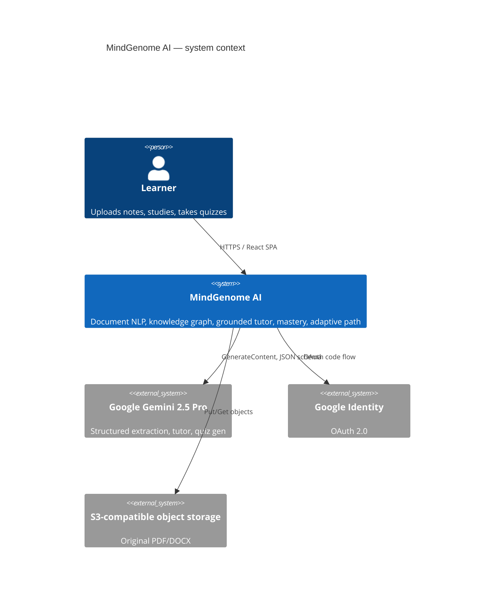
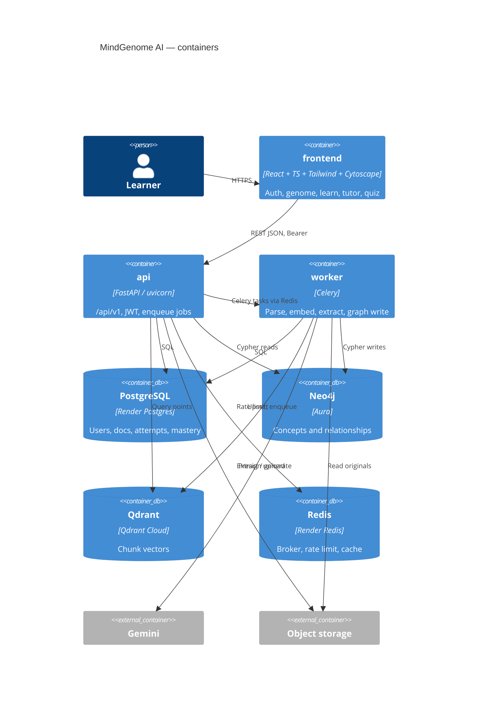
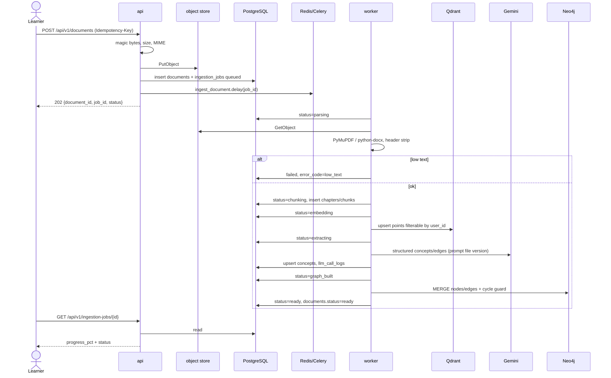
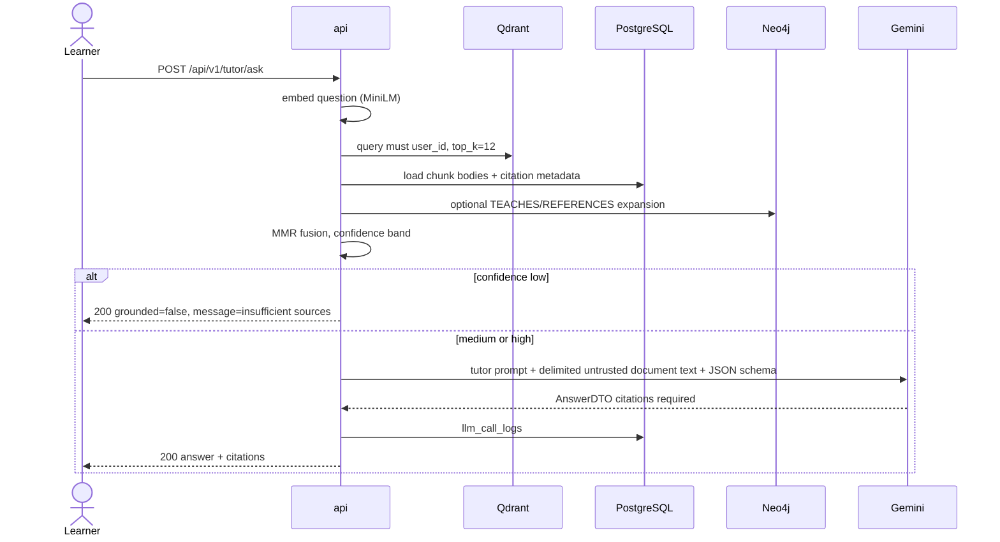
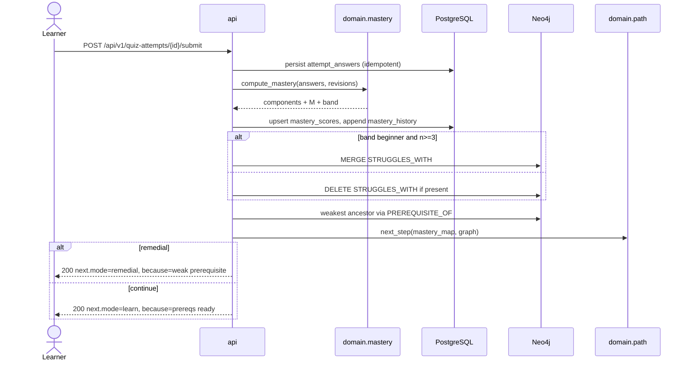

# System architecture

Modular monolith. One API process, one worker process, three datastores.
Cytoscape is visualization only.

## C4 — context



## C4 — containers



## Sequence — document ingestion



## Sequence — hybrid (graph-augmented) RAG



## Sequence — quiz → mastery → dependencies → remedial



## Package layout (backend)

Domain **must not** import FastAPI, Celery, SQLAlchemy, Neo4j, Qdrant, LangChain, or Google SDKs.

```
backend/
  pyproject.toml
  alembic.ini
  alembic/versions/
  app/
    main.py
    api/                # routers, deps, error handlers
      v1/
        auth.py
        documents.py
        graph.py
        tutor.py
        learning.py
        quizzes.py
        mastery.py
        dashboard.py
    schemas/            # Pydantic API models
    services/           # use cases (orchestration)
    domain/             # pure: mastery, path, validation
      mastery.py
      path.py
      evidence.py
    repositories/       # ports
    adapters/           # postgres, neo4j, qdrant, gemini, s3, redis
    workers/            # celery app + tasks
    core/               # settings, logging, security
    prompts/            # versioned .md + .schema.json (not inline)
  tests/
    unit/
    integration/
    golden/
```

Frontend layout is in `docs/FRONTEND.md`.

## SoT rules

| Data | Write | Read path |
| --- | --- | --- |
| Mastery numbers, attempts | Postgres | API → domain → Postgres |
| STRUGGLES_WITH | Neo4j after Postgres commit | Dashboard graph |
| Chunk text | Postgres | RAG loads bodies after Qdrant ids |
| Vectors | Qdrant | Tutor retrieve |
| Prerequisite topology | Neo4j | Path planner |
| Cytoscape elements | never persisted | Built from graph API |

## Alembic plan

1. Sprint 1: `001_initial` = `docs/data/001_initial_schema.sql` (enums, tables, RLS, indexes).
2. Later sprints: additive migrations only; no rewrite of 001.
3. Expand/contract for enum changes.
4. CI: `alembic upgrade head` against the Postgres service container before tests.
5. Render deploy: release command `alembic upgrade head` gated on health of Postgres.

## Risks (owned)

| Risk | Mitigation |
| --- | --- |
| Gemini Pro cost on every extract | Log tokens; later ask to route extract→Flash (not swapping stack) |
| Noisy edges | confidence + provenance + user confirm + 0.75 adaptive floor + cycle guard |
| Three-store drift | job state machine, idempotent upserts, retry from last stage |
| Neo4j Community tenancy | property scope + constraints + query guards + tests that a second user_id returns empty |
| Messy PDFs | low-text fail-closed, golden files in S2 |
| Prompt injection via PDF | delimited untrusted text, citations required, Pydantic answer schema |
